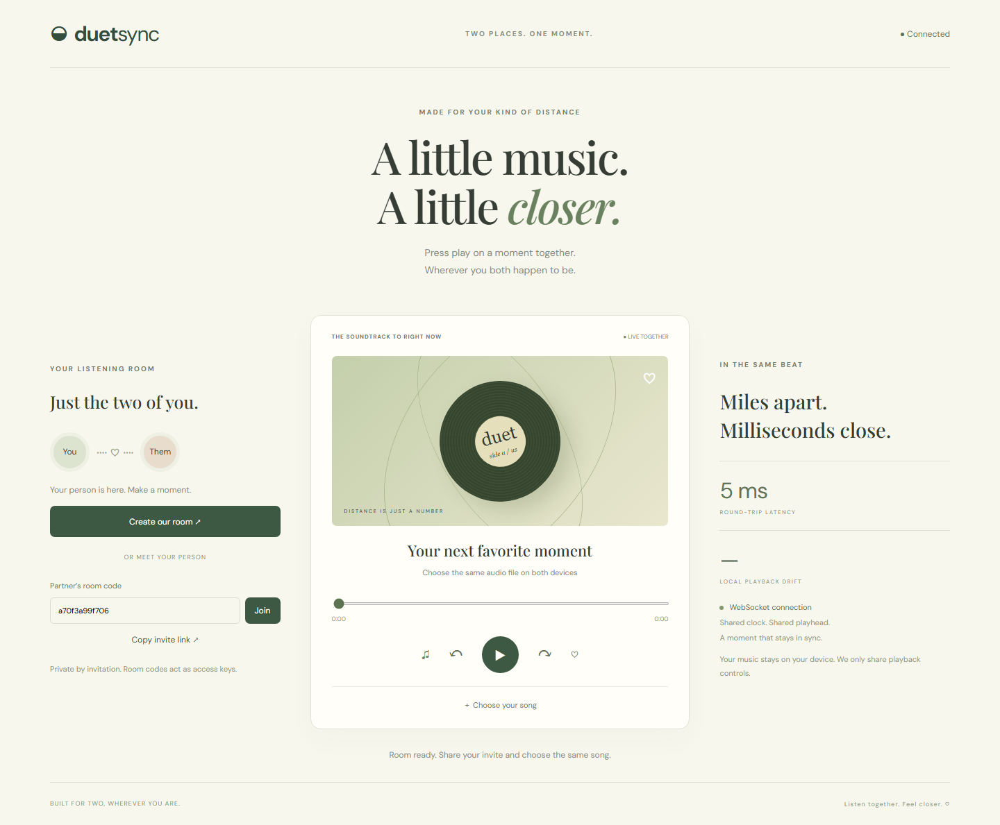

# Network Systems — DuetSync

### Two places. One moment.

DuetSync is a synchronized music player for long-distance couples. Create a private-by-invitation listening room, share its link, select the same audio file on both devices, and control playback together.

**Project type: Computer Networks / Distributed Systems / Full-stack Web Application.** This is **not a Machine Learning (ML), Deep Learning (DL), or Generative AI project**. It uses deterministic networking and playback synchronization; there is no trained model, inference pipeline, or training dataset.



## Features

- Two-person rooms with cryptographically random 12-character room codes.
- Copyable invite links and live partner presence.
- Shared play, pause, seeking, and ten-second skip controls.
- WebSocket messages for real-time, bidirectional coordination.
- Ping/pong clock-offset estimation and displayed round-trip latency.
- Server-authoritative playback state with monotonic revisions.
- Periodic playback drift measurement and correction.
- Local audio selection: audio bytes are never uploaded to the server.
- Responsive sage-and-cream interface with an original CSS record illustration.

## Quick start

Requires Node.js 20 or later and npm.

```sh
npm ci
npm start
```

Open `http://localhost:3000` in two browser tabs or devices that can reach the server.

1. Click **Create our room** on the first device.
2. Copy the invitation link and send it to your partner.
3. On the other device, open that link and click **Join**.
4. Choose the **same version of the same audio file** on both devices.
5. Click Play. Either listener can pause or seek for both.

For separate devices on your home network, use the server computer's LAN address instead of localhost. For long-distance listening, deploy the Node server to a host that supports persistent WebSocket connections, expose it over HTTPS/WSS, and share that public origin. `PORT` defaults to `3000`; the server binds to `0.0.0.0`. Localhost links cannot be used by a remote partner.

## Network concepts

### Client–server architecture and WebSockets

The HTTP server serves the interface and upgrades connections to WebSockets. Each room has at most two connected clients. The server serializes accepted playback commands and broadcasts the resulting state to both clients, including the sender.

```text
Listener A  ←── WebSocket ──→  Node.js room server  ←── WebSocket ──→  Listener B
 local audio                   authoritative state                   local audio
```

### Clock synchronization

For a ping sent at client time `t0`, returned at client time `t1`, and stamped by the server at `ts`:

```text
roundTripTime = t1 - t0
clockOffset  = ts - (t0 + t1) / 2
serverNow    = clientNow + clockOffset
```

The client keeps the clock estimate from its lowest-round-trip sample, reducing the influence of queueing delays. This assumes roughly symmetric network delay. It resembles an NTP-style offset estimate but is not a complete NTP implementation. Samples are collected every five seconds.

### Scheduled state and drift correction

A state includes `{ playing, position, at, revision }`. The server schedules new controls 350 milliseconds ahead to give both clients time to receive them. A late client computes its catch-up position from the server timestamp:

```text
expectedPosition = position + (serverNow - at) / 1000  // when playing
```

A client applies the state at the scheduled time, cancels superseded timers, and rejects older revisions. Every second it measures the difference between local and expected playback; while playing, differences greater than 150 milliseconds trigger a seek correction. These values are implementation targets, **not a guarantee of audible synchronization**. Network asymmetry, browser timers, buffering, decoding, and audio hardware latency affect results.

### Lifecycle and consistency

New participants receive the latest room state. Rooms are removed when the last participant disconnects. Concurrent controls use server arrival order. A disconnected client pauses locally; reload and rejoin to resume. There is no automatic reconnection or persistent session recovery.

## Project structure

| File | Purpose |
| --- | --- |
| `server.js` | HTTP routes, WebSocket protocol, room membership and authoritative state |
| `public/index.html` | Accessible playback and room interface |
| `public/style.css` | Responsive styling and CSS album artwork |
| `public/app.js` | Clock sampling, audio playback, invitations and drift correction |
| `server.test.js` | Integration test with real WebSocket clients |
| `docs/project-preview.png` | Actual desktop application screenshot |
| `docs/mobile-preview.png` | Actual mobile interface screenshot |

## Validation

```sh
npm test
node --check public/app.js
```

The integration test checks HTTP serving, room creation, ping/pong, state revisions, late joins, identical broadcasts, room capacity and empty-room cleanup. Browser verification also exercised two-tab room pairing and checked that the 390px mobile layout does not overflow horizontally. Audio synchronization across physically separate devices has not been measured.

## Privacy, limitations and deployment

- Use audio you are entitled to play. There is no bundled copyrighted music or streaming-service integration.
- Both listeners must select matching files. The app does not fingerprint or verify that the files match.
- Browser autoplay rules may require an initial Play click on each device.
- Room codes are bearer access keys. Anyone with a code can join if a slot is available. There are no accounts or identity checks.
- Playback state and room membership are held in memory and disappear when the server restarts.
- A single server process is supported. Multiple replicas require a shared room store and pub/sub coordination.
- This prototype validates control messages and bounds WebSocket payload size, but has no production rate limiting, idle-room expiry, authentication, origin allowlist or abuse monitoring. Add these before opening a large public service.
- Remote deployment requires HTTPS/WSS to encrypt control traffic. Music stays local, but the server observes connection metadata and playback state.
- Google Fonts is used for optional typography; the interface falls back to system fonts when unavailable.

## Future work

File fingerprint checks, explicit partner audio readiness, reconnect recovery, heartbeats for stale sockets, access-controlled rooms, and measured multi-device synchronization benchmarks.

## License

MIT. See [LICENSE](LICENSE).
