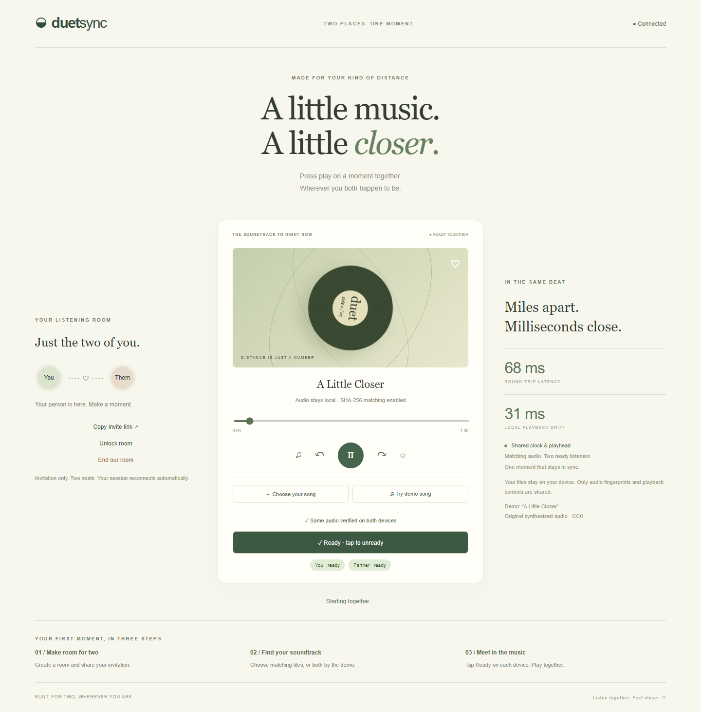
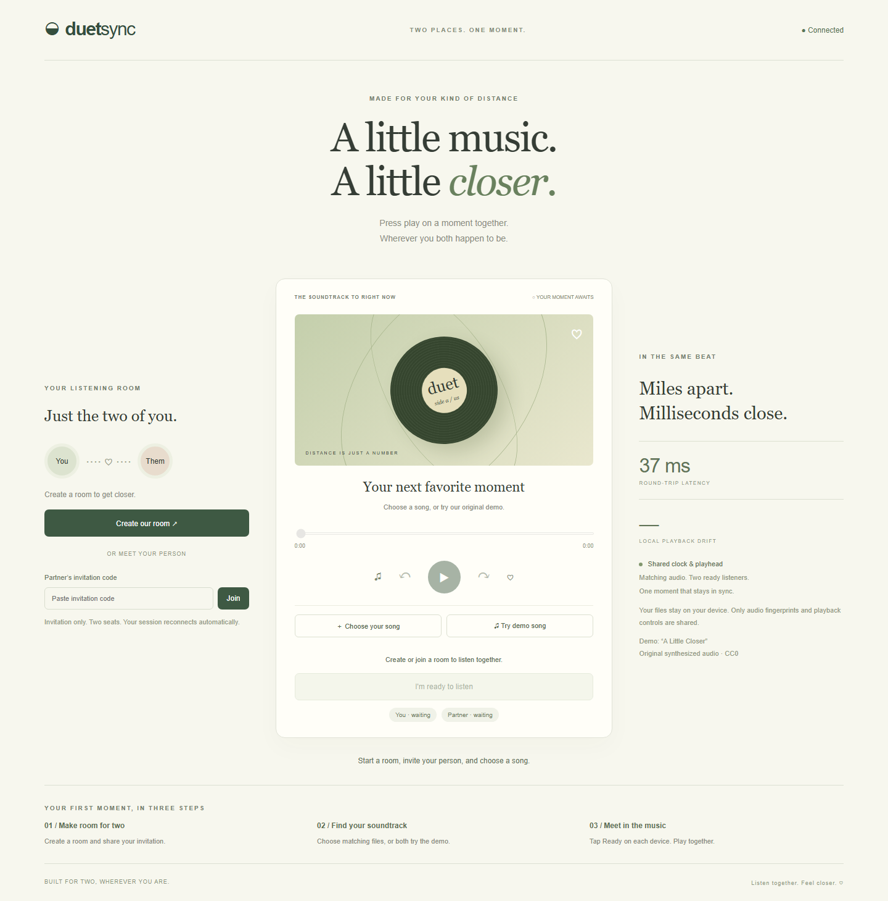
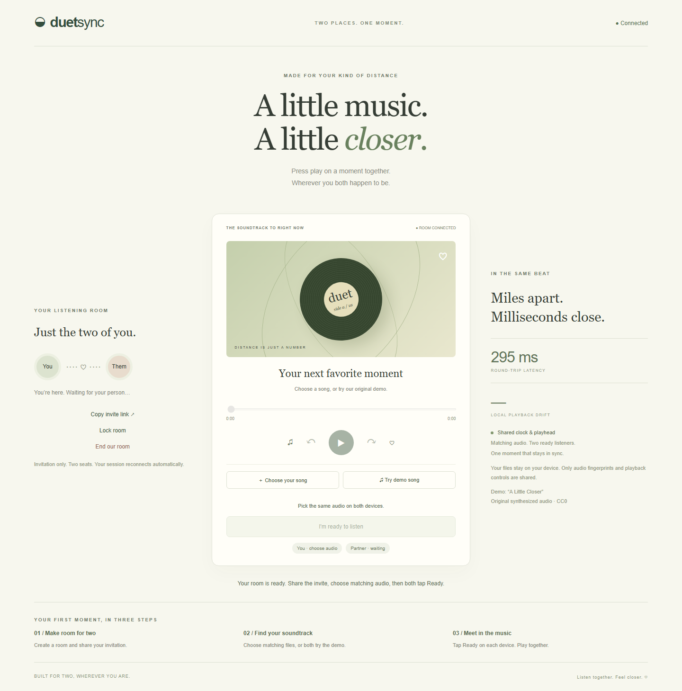
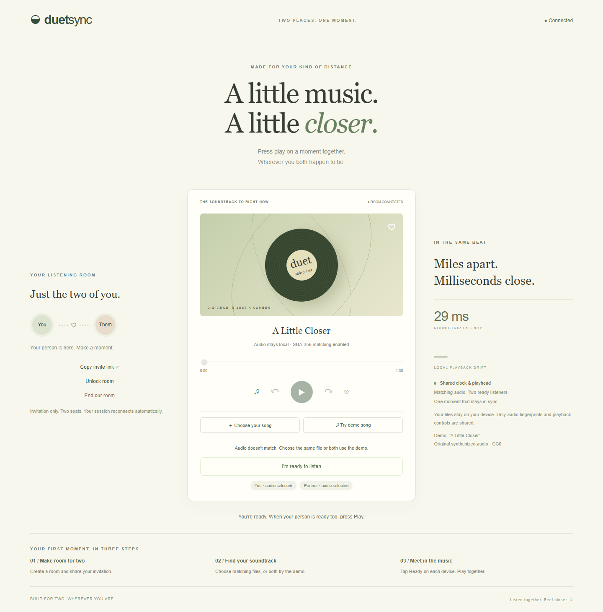
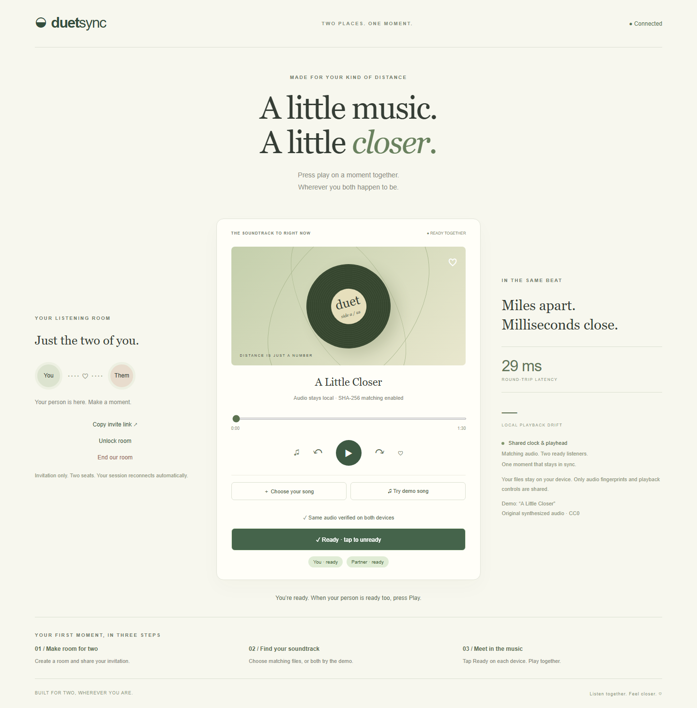
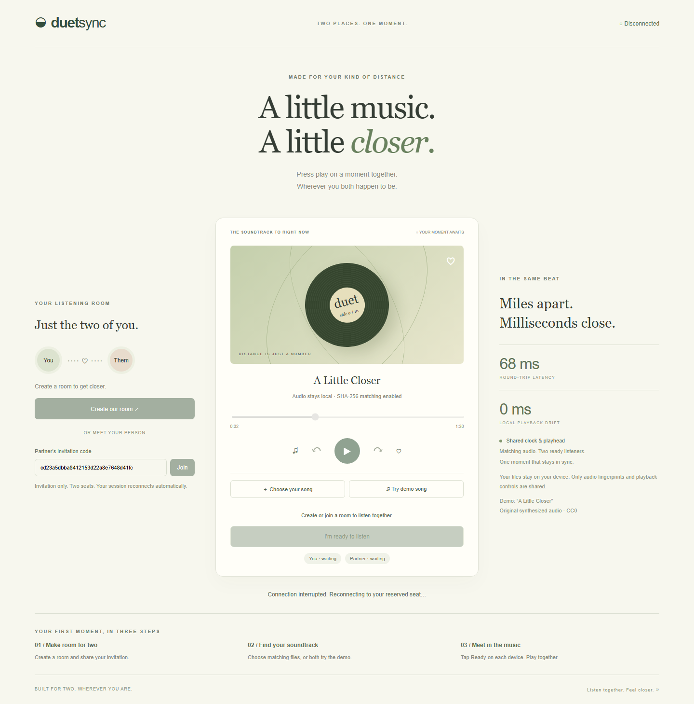
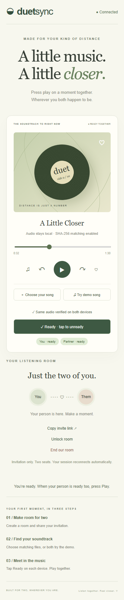

# Network Systems — DuetSync

### Two places. One moment.

**[Open the live product →](https://duetsync.vercel.app)** · [Backend health](https://wweuhpqsuwwcbgheckve.supabase.co/functions/v1/duet-sync/healthz) · [Operations guide](docs/OPERATIONS.md) · [Browser verification](docs/browser-verification.json)

DuetSync gives long-distance couples a private listening room: invite your person, choose the same song, get ready, and press play together. Shared controls coordinate both playheads while your audio files stay on your own devices.

**Project type: Computer Networks / Distributed Systems / Full-stack Web Application.** This is **not ML, DL, or Generative AI**. Playback uses deterministic clock estimation, versioned state and drift correction; there is no trained model, inference, or training dataset.



## Try the live demo in a minute

1. Open **[duetsync.vercel.app](https://duetsync.vercel.app)** and click **Create our room**.
2. Click **Copy invite link** and open it on your partner's device, or in a separate browser/private window. Click **Join** there.
3. On **both** devices, click **Try demo song** to load “A Little Closer,” our original 90-second synthesized sample.
4. Each person clicks **I'm ready to listen**. Playback becomes available after the audio fingerprints match and both are ready.
5. Press **Play**. Either person can pause, seek, or skip ten seconds for both.

To use your own music, both listeners must select the **exact same audio file**. File hashing happens locally; files are not uploaded. The sample can also be [downloaded here](https://duetsync.vercel.app/demo.wav).

## Product showcase

These are actual application screenshots captured during the automated two-listener flow. Test rooms are ended after verification, so any pictured invitation has expired.

### An inviting room for two



### Share an invitation, then meet in the music



### Catch different recordings before playback



### Matching audio, two ready listeners



### Recover a dropped connection



### Made for your phone, too



## What's implemented in v2

| Capability | Product behavior |
| --- | --- |
| Durable rooms | Shared PostgreSQL state survives worker restarts and is visible across backend instances |
| Private invitations | Random 128-bit invitation codes; fragment links keep codes out of ordinary HTTP requests |
| Listener sessions | Random 256-bit per-tab session credentials, hashed before storage |
| Two reserved seats | Disconnections reserve the listener's seat; another person cannot silently take it |
| Room locks | Creator can lock/unlock; rooms automatically lock when both seats are occupied |
| File fingerprinting | SHA-256 over the full file plus a duration check prevents different recordings from playing together |
| Readiness | Both listeners explicitly unlock browser audio and signal readiness before playback |
| Shared transport | Play, pause, seek and skips use server-authoritative, scheduled playback state |
| Drift correction | Small drift adjusts playback rate within ±3%; drift over 250 ms triggers a seek |
| Recovery | Exponential backoff with jitter, rejoin, state reload, and explicit readiness after reconnect |
| Heartbeats | Application health checks, WebSocket ping/pong, presence leases and stalled-connection recovery |
| Lifecycle | Creator ends the room; partner may leave; inactive rooms expire after 30 minutes, with a 24-hour hard limit |
| Abuse controls | Durable attempt/action quotas, payload limits, bounded queues, slow-consumer limits and origin validation |
| Deployment | HTTPS frontend on Vercel, WSS backend on Supabase Edge Functions, private PostgreSQL storage |
| Verification | Server integration tests, automated two-browser product flow, mobile checks and CI |

## How synchronization works

```text
Listener A ─── WSS ──→ Supabase WebSocket worker A ──┐
  local audio                                     ├── PostgreSQL CAS room store
Listener B ─── WSS ──→ Supabase WebSocket worker B ──┘
  local audio          shared room logic

Vercel serves the static interface over HTTPS.
Workers share durable state; clients never receive database credentials.
```

### Shared clock

Clients send timestamped pings. Given client send time `t0`, client receive time `t1`, and server timestamp `ts`:

```text
roundTripTime = t1 - t0
clockOffset  = ts - (t0 + t1) / 2
serverNow    = clientNow + clockOffset
```

The lowest-round-trip sample supplies the current offset estimate. Clients resample every five seconds and after returning to the foreground. This is an NTP-style estimate that assumes roughly symmetric delays, not a full NTP implementation.

### Scheduled playback

A state contains `{ playing, position, at, revision }`. Commands are scheduled **1,200 ms ahead**, leaving time for durable storage and cross-worker delivery. Workers refresh active room snapshots every **400 ms**, with overlapping refreshes suppressed. When a message arrives late, the client computes the expected playhead from its timestamp rather than starting from zero.

```text
expectedPosition = position + max(0, serverNow - at) / 1000  // while playing
```

A pause toggle projects the current authoritative playhead to the scheduled pause time, avoiding a backward jump. Seeks use the explicitly requested destination. Every 500 ms, clients measure local drift and either gently adjust playback rate or seek to catch up.

These are software targets, **not a guarantee of acoustically simultaneous output**. Network asymmetry, browser scheduling, buffering and audio output hardware all contribute latency.

### Consistency, readiness and recovery

PostgreSQL atomically compares the document version before saving a change. Concurrent room mutations retry against fresh state. Playback commands also carry the last observed playback revision, so a delayed control cannot overwrite a newer one. Competing joins cannot claim a third seat.

New connections load current state. A session token reclaims the listener's reserved seat; a connection identifier prevents an old socket's close handler from marking its replacement offline. Reconnect pauses the room and clears the reconnecting listener's readiness. The partner waits safely until that listener taps Ready again. Presence leases expire after 20 seconds if a worker dies without a close event.

## Stack and source map

| Component | Implementation |
| --- | --- |
| Interface | Semantic HTML, CSS, browser Audio API and Web Crypto |
| Room protocol | Shared JavaScript room protocol used by local Node.js and hosted Edge workers |
| WebSocket transport | Native Edge WebSockets; `ws` for the local Node adapter |
| Persistence | Supabase PostgreSQL through a service-role-only RPC and compare-and-swap |
| Frontend hosting | Vercel production deployment |
| Backend hosting | Supabase Edge Functions with platform-provided server credentials |
| Testing | Node test runner, Playwright Chromium, GitHub Actions |

```text
public/                          Interface, playback client and original demo audio
lib/app.js                       Local HTTP / WebSocket adapter
lib/hub.js                       Shared connection protocol, heartbeats and coordination
lib/rooms.js                     Room membership, capabilities and playback rules
lib/store.js                     Development memory store and durable database adapter
server.js                        Local / self-hosted Node entrypoint
server.test.js                   Real WebSocket and concurrency integration tests
supabase/functions/duet-sync/     Hosted backend entrypoint and dependency map
supabase/migrations/             Ordered schema, service-role access and expiry cleanup
scripts/                         Static build and original-audio generator
test/listening.spec.js           Complete two-browser product-flow verification
docs/showcase/                   Product screenshots
.github/workflows/verify.yml     Automated test and build checks
```

## Run locally

Requires **Node.js 22+** and npm; CI uses Node.js 24.

```sh
npm ci
npm start
```

Open `http://localhost:3000`. Local development uses a memory store and the same room logic, without cloud credentials. For a second listener, use another browser/private window; session credentials are scoped to a browser tab. Use a free `PORT` if another app is already running on 3000.

```sh
npm test
npx playwright install chromium
npm run test:e2e
npm run build
```

The local browser test starts a dedicated test server on **3187**. To run the same product flow against the live deployment:

```powershell
$env:BASE_URL='https://duetsync.vercel.app'
npm run test:e2e
```

The build writes `dist/` with the configured public WSS endpoint. `DUET_SOCKET_URL` can override that endpoint during build. Secrets are never included in the static frontend. See the [operations guide](docs/OPERATIONS.md) for deployment, schema and environment instructions.

## Verification and practical limits

The [checked-in browser report](docs/browser-verification.json) records the tested URL, sampled playhead drift and completed checks. The browser test uses two independent Chromium contexts and exercises invitations, audio mismatch rejection, readiness, actual media playback, seeking, pause, socket reconnection, reserved-seat recovery, room ending and a 390px mobile viewport. JavaScript page errors must be absent for the test to pass.

The verified live run recorded **11.2 ms median** and **22.5 ms maximum** playhead difference across 12 samples, with **zero page errors**. These are results from two independent browser contexts on one machine using the public backend, not a distant-device acoustic benchmark. Seven server integration tests also passed.

Server integration tests additionally verify cross-instance state sharing, concurrent seat claims, stale revisions, ownership, expired rooms, origin checks, malformed messages, hidden environment files, payload limits and quotas. The database rejects unauthenticated RPC access. Security advisors report no warnings; private tables intentionally have RLS enabled without public policies.

**Scope:** this is a deployed, hardened product demo. It has not been independently security audited, load-tested at scale, or acoustically measured across physically distant devices. No uptime SLA or cross-device audio-latency guarantee is claimed.

## Privacy and operating boundaries

- Local audio stays local. The backend stores fingerprints, duration, room membership, readiness and playback state; names of local files are not sent.
- Invites are bearer capabilities. Keep them private; the creator can lock the room or end it. This is invitation-based access, not verified personal identity or an account login.
- Tokens are kept in `sessionStorage`; losing that storage loses the reserved seat credential. Ending the room and creating a fresh one is the recovery path.
- Full-byte hashing requires matching files, including metadata. Different encodings or metadata tags can produce different hashes for the same song.
- Audio files are limited to 100 MB and 24 hours; supported formats depend on the browser. File hashing temporarily allocates file-sized memory.
- Room and quota tables are private with RLS and no browser policies. A fixed-search-path privileged RPC is callable only by the backend service role. Platform credentials never reach browsers.
- Scheduled database cleanup runs every ten minutes. Expiry is enforced on access even before physical cleanup.
- Workers have platform lifetime limits, so reconnect support is part of normal operation. Background tabs and sleeping mobile devices may pause or delay playback.
- Rooms use periodic snapshot coordination. For large scale, replace frequent reads with shared pub/sub and benchmark storage throughput and cost.
- Use only music you have the right to play. No Spotify, Apple Music or other commercial streaming integration is included.

## Next roadmap

Completed: matching-file checks, partner readiness, reconnect recovery, stale-socket heartbeats, access-controlled rooms, durable coordination, expiry cleanup, original sample audio, deployment, automated browser verification and the product gallery.

Remaining work: physical two-device acoustic benchmarks, Safari/iOS/Android coverage, high-volume load and chaos testing, push-based cross-worker pub/sub, optional account identity, and independently reviewed security controls. These are future capabilities rather than implied features of this release.

## License

Application code is [MIT](LICENSE). The generated “A Little Closer” demo audio is dedicated to the public domain under [CC0](https://creativecommons.org/publicdomain/zero/1.0/); it contains no third-party recordings or samples. CSS record artwork is original to this project.
